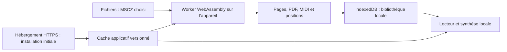

# Architecture

## Propriétaires

- `import-score.js` contrôle l’archive, le délai et l’annulation ; le fichier
  d’origine est conservé sans modification. Le worker possède le moteur WASM.
- `import-worker.js` produit la gravure, le MIDI et les positions. Pour une source
  MuseScore 2, les harmonies de la copie intermédiaire ne deviennent pas un nouvel
  accompagnement automatique. Le parseur XML du navigateur réalise cette adaptation.
- `playback.js` possède la lecture du MIDI, le clic ajouté et la normalisation des
  coordonnées. Les événements de reprise restent dans leur ordre temporel.
  Pour une partition sans notes, la durée fournie par le moteur complète le MIDI
  presque vide et permet de conserver le métronome.
- `library.js` possède les transactions IndexedDB et les URL temporaires d’affichage.
- `app.js` possède le transport, les réglages et la présentation des pages.
  Les ouvertures sont sérialisées jusqu’à l’écriture de la dernière partition :
  pages, URL et réglages restent rattachés au même document.
- `sw.js` sert uniquement le cache de sa version. L’installation vérifie chaque
  ressource avant activation ; les mises à jour attendent la fermeture des anciennes
  fenêtres ou l’action explicite de l’utilisateur.
- `setup_assets.py` possède les versions et empreintes des dépendances.
- `build_web.py` copie une liste explicite vers `web-dist/` et lie les ressources
  à une version. Une ancienne sortie modifiée ou étrangère n’est pas supprimée.

## Données et limites

IndexedDB conserve MSCZ d’origine, pages SVG, PDF, MIDI préparé, manifeste et
réglages. Le cache applicatif contient le lecteur, le moteur, les sons et les
notices ; son renouvellement laisse la bibliothèque intacte.

Les glyphes des pages d’essai sont des tracés SVG ; l’affichage ne dépend pas
de polices musicales installées sur l’appareil. Le PDF est celui du moteur web.
Les URL de pages sont des Blob locaux, révoqués lorsque la partition change.

La synthèse utilise FluidSynth et ScriptProcessor. Le tick MIDI pilote le curseur.
La hauteur de `readerDock` inclut le bouton de masquage et la zone de sécurité iOS.
Le téléchargement initial nécessite HTTPS ; aucune API de conversion distante
n’est utilisée pendant l’import. Les outils de conversion native restent historiques
et ne font pas partie de `web-dist/`.
