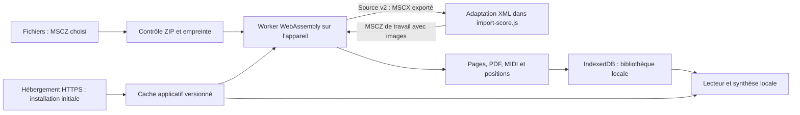

# Architecture

## Propriétaires

- `import-score.js` contrôle l’archive, l’empreinte, le délai et l’annulation ;
  le fichier d’origine est conservé sans modification. Pour une source MuseScore 2,
  le premier chargement du worker fournit un MSCX à adapter avec le parseur XML
  du navigateur. Les harmonies ne deviennent pas un nouvel accompagnement automatique.
  Le numéro du barré et sa première corde proviennent du fichier d’origine, après
  vérification des points et du nombre de diagrammes. La copie MSCZ conserve les
  pièces jointes pour éviter de perdre les images lors du second chargement.
- `import-worker.js` possède le moteur WASM et produit la gravure, le PDF, le MIDI
  et les positions. Il recharge la copie MSCZ adaptée avant l’export final pour
  une source v2 ; son cycle de vie est borné à l’import.
- `playback.js` possède la lecture du MIDI, le clic ajouté et la normalisation des
  coordonnées. Les événements de reprise restent dans leur ordre temporel.
  Pour une partition sans notes, la durée fournie par le moteur complète le MIDI
  presque vide et permet de conserver le métronome.
  La largeur des segments permet la sélection d’une note après normalisation du
  clic dans la page ; les reprises privilégient l’occurrence proche de la lecture.
- `library.js` possède les transactions IndexedDB et les URL temporaires d’affichage.
- `app.js` possède le transport, les réglages et la présentation des pages.
  Il démarre depuis le segment sélectionné à l’arrêt et met en pause sans déplacement
  pendant la lecture ou le décompte ; `playback.js` possède la sélection géométrique.
  Les ouvertures sont sérialisées jusqu’à l’écriture de la dernière partition :
  pages, URL et réglages restent rattachés au même document.
- `sw.js` sert uniquement le cache de sa version. L’installation vérifie chaque
  ressource avant activation ; les mises à jour attendent la fermeture des anciennes
  fenêtres ou l’action explicite de l’utilisateur. Seule la fenêtre ayant demandé
  la mise à jour se recharge automatiquement ; les autres peuvent garder l’ancien code.
- `setup_assets.py` possède les versions et empreintes des dépendances.
- `build_web.py` copie une liste explicite vers `web-dist/` et lie les ressources
  à une version. Il refuse les fichiers étrangers. Un ancien fichier devenu inutile
  n’est supprimé que si son empreinte correspond à la précédente sortie connue.

## Données et limites

IndexedDB conserve MSCZ d’origine, pages SVG, PDF, MIDI préparé, manifeste et
réglages. Le cache applicatif contient le lecteur, le moteur, les sons et les
notices ; son renouvellement laisse la bibliothèque intacte.
Chaque appareil et contexte d’installation possède ses propres données ; aucune
synchronisation entre Safari, l’app installée, l’iPhone et l’iPad n’est promise.
Une mise à jour du lecteur ne regrave pas les pages enregistrées : il faut réimporter
le MSCZ pour bénéficier d’une correction d’import ou de gravure.

Les glyphes des pages d’essai sont des tracés SVG ; l’affichage ne dépend pas
de polices musicales installées sur l’appareil. Le PDF est celui du moteur web.
Les URL de pages sont des Blob locaux, révoqués lorsque la partition change.

La synthèse utilise FluidSynth et ScriptProcessor. Le tick MIDI pilote le curseur.
La hauteur de `readerDock` inclut le bouton de masquage et la zone de sécurité iOS.
Le téléchargement initial nécessite HTTPS ; aucune API de conversion distante
n’est utilisée pendant l’import. Les outils de conversion native restent historiques
et ne font pas partie de `web-dist/`.

La publication et l’installation relèvent de [INSTALLATION.md](INSTALLATION.md) ;
leur présence dans cette architecture ne constitue pas une preuve de déploiement.
